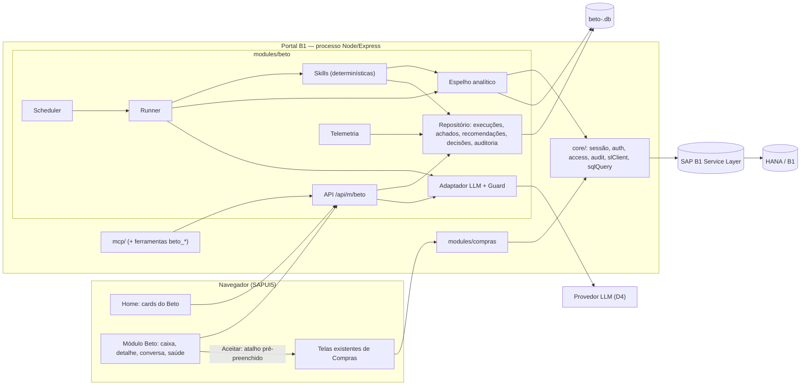
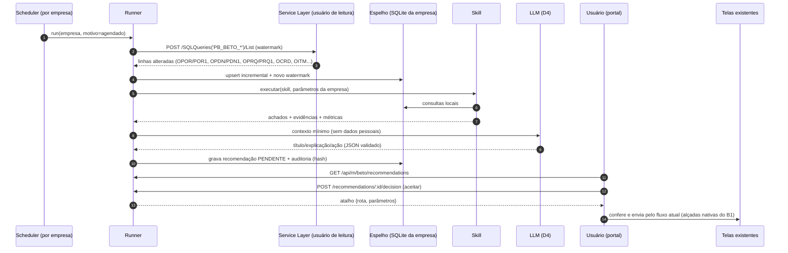

# BETO — Blue Ocean Procurement Intelligence
## Documento de arquitetura técnica · v0.1 (para validação)

| | |
|---|---|
| Base auditada | `vagnerrodrigues/PortalB1_Fiori`, branch `main`, commit `e4bf6e9` (20/11/2026) |
| Ambiente de referência | Servidor Windows do cliente (SILCON TESTES), Node 22, SAP B1 10.0 HANA, Service Layer `IT506788-HANA01:50000` |
| Status | **Validado em 20/11/2026.** Etapas 1 (fundação) e 2 (espelho analítico + S1/S2) implementadas. Próxima: etapa 3 (S3 pontualidade, S4 variação de preço). |

---

## Sumário

1. Resumo executivo
2. Auditoria técnica do Portal (estado atual)
3. Princípios de arquitetura do Beto
4. Arquitetura técnica
5. Diagrama de componentes
6. Diagrama de integração
7. Modelo entidade-relacionamento
8. Contratos das APIs
9. Estrutura de skills
10. Plano de segurança
11. Estratégia de monitoramento
12. Plano de implementação por etapas
13. Decisões arquiteturais pendentes
14. Riscos conhecidos

---

## 1. Resumo executivo

O Beto entra no portal como **mais um módulo** (`server/modules/beto`), seguindo o mesmo padrão dos módulos existentes. Ele reaproveita, sem duplicar:

- **Do núcleo:** login, sessão, empresas (tenants), controle de acesso, auditoria e o cliente do Service Layer.
- **Do servidor MCP (`/mcp`):** os tokens pessoais e as ferramentas que já existem.
- **Do módulo Compras:** o adaptador `sl.js` / `sl-procure.js`, o painel e o mapa de relações.

A inteligência fica em duas camadas:

1. **Skills analíticas determinísticas.** Leem o SAP só para leitura, por meio de consultas SQL registradas (SQLQueries) e de um espelho analítico local por empresa. Calculam achados com números verificáveis e evidências rastreáveis até o documento no B1.
2. **Camada de linguagem (LLM).** Explica, prioriza e conversa sobre esses achados. Ela nunca calcula números nem toca no SAP diretamente.

**Regra de ouro:** o Beto **recomenda**; o humano **decide**; o portal existente **executa**, pelos fluxos e alçadas nativos do B1. O Beto não cria pedidos, não aprova, não paga e não altera cadastros.

---

## 2. Auditoria técnica do Portal (estado atual)

### 2.1 Framework e linguagem

| Camada | Tecnologia | Evidência |
|---|---|---|
| Frontend | **SAPUI5 1.136** (tema Horizon), carregado da CDN `ui5.sap.com`; libs `sap.m`, `sap.f`, `sap.tnt`, `sap.ui.layout`, `sap.ui.unified` | `webapp/index.html`, `webapp/manifest.json` |
| Backend | **Node.js ≥ 18** (o servidor de referência roda 22.x) + **Express 4**; JavaScript CommonJS, sem TypeScript | `package.json`, `server/index.js` |
| Dependências | Apenas `express` e `nodemailer` | `package.json` |
| Testes | Scripts Node com `assert` (79 verificações, modo demo e formato do SL) | `server/test/*.test.js` |
| Build | Nenhum: o front é servido como arquivos estáticos | `ui5.yaml` só para ferramentas |

### 2.2 Arquitetura frontend e backend

```
SAPUI5 (webapp/) ──fetch /api──▶ BFF Node/Express (server/) ──HTTPS OData v4──▶ SAP B1 Service Layer ──▶ HANA
                                   ├─ core/      sessão, login, empresas, acesso, auditoria, SQLQueries, e-mail, settings
                                   ├─ modules/   compras · despesas · parceiros · relatorios · ia · admin
                                   └─ mcp/       servidor MCP (JSON-RPC 2.0, Streamable HTTP) para assistentes de IA
```

- **Front:**
  - Um `Component` com roteador; cada tela é uma XML view com controller.
  - Shell próprio: menu lateral e cabeçalho (`App.view.xml`).
  - O cliente REST `model/api.js` envia o cabeçalho anti-CSRF `X-Requested-With`.
- **BFF:**
  - Cada módulo exporta `{ id, title, tiles, createRouter() }` e fica montado em `/api/m/<id>`, protegido por guarda de módulo.
  - Rotas públicas (sem login) ficam em `/api/public/<id>`. Hoje só existe a resposta de cotação pelo fornecedor.
  - Cada módulo tem um adaptador real (`sl*.js`) e um de demonstração (`mock.js`), escolhido pela variável `MOCK=1`.

### 2.3 Banco de dados

O portal **não tem banco de dados próprio**. Os dados de negócio ficam 100% no SAP B1, e o README declara o princípio "zero UDF/UDT". O que o portal guarda localmente:

| Dado | Onde | Formato |
|---|---|---|
| Cotações online (convites, tokens, respostas, vencedores) | `data/rfq/<empresa>/<n>.json` | JSON por registro, gravação atômica (`core/store.js`) |
| Tokens de IA (hash + senha B1 cifrada) | `data/ai-tokens/<empresa>/<id>.json` | JSON; AES-256-GCM |
| Configurações por empresa | `config/settings/<empresa>.json` | JSON; segredos cifrados com `config/secret.key` |
| Empresas, acesso e CFOP padrão | `config/tenants.json` | JSON, editado à mão |
| Auditoria | `logs/audit.log` | JSON Lines, sem rotação |
| Sessões | memória do processo | `Map` (perde-se ao reiniciar) |

**Conclusão:** o Beto precisa de persistência própria (histórico, auditoria e espelho analítico). Isso é uma **decisão pendente (D1)**, porque o portal não tem banco hoje.

### 2.4 Autenticação

- O login é feito **no Service Layer com o usuário e a senha do próprio B1** (`core/auth.js`). O portal guarda só o cookie `B1SESSION`/`ROUTEID`, nunca a senha.
- A sessão do portal usa um cookie `pcb1_sid` (HttpOnly, SameSite=Strict, Secure opcional), expira após 25 min de inatividade e fica em memória.
- A **sessão do SL atende uma chamada por vez**. Por isso o portal faz chamadas em sequência e usa cache para não travar a tela do usuário. Medido no cliente: 2 a 5 s por chamada.
- **MCP:** token pessoal `pb1_<empresa>_<id>_<segredo>`. O portal grava só o hash do token e a senha B1 cifrada, para abrir a sessão SL **com as permissões do próprio usuário**. O escopo é `read` ou `write`, com limite de 120 chamadas por minuto.

### 2.5 Usuários, empresas e permissões

- **Empresas:** são definidas em `tenants.json`, com URL do SL, CompanyDB, módulos contratados, regras de acesso e padrões fiscais. Cada empresa é um banco B1.
- **Usuários:** são os **usuários nativos do B1 (OUSR)**. O portal não tem cadastro próprio de usuários.
- **Acesso** (`core/access.js`):
  - **Superusuário do B1:** acessa todos os módulos.
  - **Demais usuários:** o acesso a cada módulo segue `moduleAccess.<módulo>.departments/users`.
  - **Dentro de Compras:** os perfis `buyers` (telas de comprador) e `receivers` (recebimento) restringem telas específicas.
  - **Módulos `adminOnly`:** só superusuário ou os usuários listados.
- **Alçadas e aprovação:** usam os **Procedimentos de Autorização nativos** do B1 (OWTM/OWDD/ODRF). O portal não reimplementa nenhuma regra de aprovação.

### 2.6 Integração com o SAP Business One

- **Canal único:** Service Layer OData v4 (`core/slClient.js`), com keep-alive, gzip, timeout de 30 s e log de chamadas acima de 1,5 s.
- **Leitura SQL:** objeto nativo `SQLQueries` (`core/sqlQuery.js`). O portal registra consultas com prefixo `PB_` e as executa via `/List`.
  - Só aceita SELECT, sem subconsulta.
  - As tabelas precisam estar liberadas no `b1s_sqltable.conf`. No cliente, `OWDD`, `WDD1` e `ODRF` **não estão liberadas**, por isso o portal cai no OData, que é mais lento.
- **Objetos de escrita usados hoje** (todos pela sessão do usuário):
  - Documentos de compra: `PurchaseRequests`, `PurchaseQuotations`, `PurchaseOrders`, `PurchaseDeliveryNotes` e `BlanketAgreements`.
  - Rascunhos e aprovação: `Drafts`, `ApprovalRequests` e `DraftsService_SaveDraftToDocument`.
  - Cadastros e anexos: `BusinessPartners` (leads) e `Attachments2`.

### 2.7 Módulos de compras

O módulo Compras (`server/modules/compras/`, cerca de 2.400 linhas) é composto por:

| Arquivo | Responsabilidade |
|---|---|
| `index.js` | Rotas REST, validações, contadores, painel, guarda comprador/recebedor |
| `sl.js` | Solicitação, rascunhos, aprovações, dados mestre, listas (`KINDS`: pr, pq, po, gr) |
| `sl-procure.js` | Ofertas, pedidos, recebimento (com CFOP/UF), contratos guarda-chuva |
| `approvalsSql.js` | Leitura rápida de OWDD/WDD1 via SQL (com fallback para OData) |
| `rfq.js` | Cotação online: convites, tokens, mapa de cotação, adjudicação |
| `dashboard.js` | Indicadores por ano, com cache de 10 min |
| `relations.js` / `sl-relations.js` | Mapa de relações entre documentos (BaseType/TargetType) |
| `itemCatalog.js` | Catálogo de itens em memória (opcional, `ITEM_CACHE=1`) |
| `mock.js` | Adaptador de demonstração com dados sintéticos |

### 2.8 APIs existentes

| Grupo | Rotas |
|---|---|
| Núcleo | `GET /api/health`, `/api/branding`, `/api/tenants`, `/api/me`; `POST /api/login`, `/api/logout` |
| Compras | `/counters`, `/items`, `/vendors`, `/cost-centers`, `/warehouses`, `/branches`, `/purchase-requests[...]`, `/docs/:kind/:source/:entry[/relations]`, `/offers`, `/orders`, `/receipts[...]`, `/agreements[...]`, `/dashboard`, `/rfq[...]`, `/approvals[...]` |
| Despesas | `/counters`, `/config`, `/accounts`, `/`, `/:source/:entry`, `/draft/:entry/finalize` |
| Parceiros | `/`, `/cnpj/:taxId`, `/cep/:cep`, `/:cardCode` |
| Relatórios | `GET /`, `POST /:id/run` (SQLQueries `PB_R_*`, extensível por `config/reports.json`) |
| IA | `/info`, `/tokens`, `/tokens/:id/revoke` |
| Admin | `/settings`, `/settings/test-email` |
| Público | `/cotacao/:token`, `/api/public/compras/cotacao/:token` |
| MCP | `POST /mcp` com 12 ferramentas, entre elas `listar_aprovacoes_pendentes`, `decidir_aprovacao`, `criar_solicitacao_compra`, `listar_pedidos_compra`, `ver_mapa_cotacao`, `consultar_contratos` e `executar_relatorio` |

### 2.9 Modelo atual dos documentos de compra

```
Solicitação (OPRQ, obj 1470000113) ──▶ Cotação online (portal, data/rfq) ──▶ Oferta de compra (OPQT, 540000006) — 1 por fornecedor
                                                                                   │ vencedor
                                                     Contrato guarda-chuva (OOAT) ─▶ Pedido de compra (OPOR, 22) ──▶ Recebimento (OPDN, 20) ──▶ NF entrada (OPCH, 18, no SAP)
Qualquer etapa pode ficar retida em Rascunho (ODRF) + Pedido de aprovação (OWDD/WDD1) pelo procedimento de autorização nativo.
```

Os vínculos entre documentos são os campos nativos `BaseType/BaseEntry/BaseLine`, `TargetType/TargetAbsEntry` e `AgreementNo`.

### 2.10 Infraestrutura e execução

- **Alvo previsto:** Windows Server.
  - Recomendado: serviço Windows via NSSM (`install-service.ps1`) e IIS como proxy reverso HTTPS (`setup-iis.ps1`, `web.config`).
  - Alternativa em uso: tarefa agendada.
- **Ambiente do cliente hoje:** o portal roda **em uma janela do PowerShell** (porta 18080), sem serviço nem HTTPS. O download do NSSM falhou na instalação.
- **Processo único**, com estado em memória (sessões, caches, índice de tokens). Não escala horizontalmente sem trocar a sessão por um store compartilhado.
- **Front** depende da CDN `ui5.sap.com`, então o navegador do usuário precisa de acesso à internet.

### 2.11 Achados relevantes para o Beto

| # | Achado | Impacto |
|---|---|---|
| A1 | Não há banco local; persistência em JSON e log sem rotação | O Beto precisa de um store transacional para histórico e auditoria (D1) |
| A2 | SL lento (2–5 s por chamada) e uma fila por sessão | Análises não podem rodar na sessão do usuário durante o uso. Precisam de cópia analítica incremental (D3) |
| A3 | Tabelas OWDD/WDD1/ODRF não liberadas no `b1s_sqltable.conf` | Limita a leitura SQL. A liberação (e de OPOR/POR1/OPDN/PDN1/OPRQ/PRQ1/OITM/OCRD) é pré-requisito do Beto |
| A4 | Qualidade de dados: 795 de 799 pedidos de 2026 "atrasados"; 7.179 pedidos abertos somando todos os anos; pedidos sem CFOP | Antes de qualquer recomendação de compra, a primeira entrega de valor é **saneamento**: pedidos esquecidos, dados fiscais faltando |
| A5 | Já existe um servidor MCP com tokens pessoais e escopo de escrita | O Beto **não cria outro canal de IA**: estende o MCP com ferramentas de leitura de insights |
| A6 | O portal age sempre com o usuário B1 da pessoa (sem usuário técnico) | Análises agendadas e autônomas exigem uma identidade de serviço só de leitura (D2) |
| A7 | Sessão e caches em memória; processo único | O Beto roda no mesmo processo no MVP, com worker separado como evolução (D6) |

---

## 3. Princípios de arquitetura do Beto

1. **Módulo, não sistema novo.** O Beto usa o mesmo núcleo, login, acesso, auditoria e shell. Ganha uma entrada "Beto" no menu e cards na tela inicial.
2. **Somente leitura no SAP.** Nenhuma skill escreve no B1. Toda ação sugerida vira um **atalho para a tela existente**, já pré-preenchida (por exemplo, "Nova solicitação" ou "Nova cotação"), onde o humano confere e envia pelo fluxo atual.
3. **Números vêm do código, não do modelo.** Cada achado tem cálculo determinístico, versão da skill e evidências (DocEntry/linha). A LLM só redige, prioriza e responde perguntas citando os achados.
4. **Dados exclusivamente internos.** As fontes são o SAP B1 da própria empresa, os dados do portal (cotações) e o feedback dos usuários. Não há busca externa de fornecedores, preços ou "oportunidades".
5. **Aprovação humana obrigatória.** Toda recomendação com impacto financeiro nasce com status `PENDENTE` e exige decisão registrada (quem, quando, justificativa).
6. **Isolamento por empresa.** O `tenant_id` aparece em toda chave, consulta, arquivo, cache e prompt. O ideal é um arquivo de banco por empresa.
7. **Rastreabilidade total.** O histórico é imutável, com cadeia de hash, e cobre cada execução, achado, recomendação, prompt enviado à LLM, resposta e decisão.
8. **Sem regras novas de compras.** O Beto não muda alçadas, procedimentos de autorização nem validações do portal. Ele observa e sugere.

---

## 4. Arquitetura técnica

### 4.1 Visão em camadas

| Camada | Componente | Responsabilidade |
|---|---|---|
| Apresentação | Telas SAPUI5 `webapp/modules/beto/*` + cards na Home | Caixa de recomendações, detalhe com evidências, conversa, painel de saúde de compras |
| API | `server/modules/beto/index.js` (`/api/m/beto/*`) | REST com guarda de módulo, perfis `beto.viewer` / `beto.decider` / `beto.admin` |
| Orquestração | `beto/scheduler.js`, `beto/runner.js` | Agenda por empresa, executa skills, controla concorrência e orçamento de LLM |
| Skills | `beto/skills/<id>/` | Cálculo determinístico + gerador de achados + template de explicação |
| Dados | `beto/warehouse.js` (espelho analítico) + `beto/repo.js` (histórico) | Extração incremental via SQLQueries; persistência por empresa |
| IA | `beto/llm.js` (provedor plugável) + `beto/guard.js` | Montagem de contexto mínimo, redação de dados sensíveis, validação da saída |
| Integração | `core/slClient`, `core/sqlQuery`, `mcp/tools` (novas ferramentas `beto_*`) | Reuso integral do que já existe |
| Observabilidade | `beto/telemetry.js`, `/api/m/beto/health`, logs JSONL | Execuções, latência do SL, custo de LLM, falhas |

### 4.2 Fluxo de uma análise agendada

1. O **scheduler** dispara a execução `run` da empresa X (ex.: diariamente às 06:00, configurável).
2. O **runner** abre a sessão SL com a **identidade de leitura** da empresa (D2) e atualiza o espelho analítico de forma incremental (`UpdateDate >= último watermark`).
3. Cada **skill** habilitada lê o espelho (não o SL) e produz `findings[]` com métrica, valor, limiar, evidências e versão.
4. O **deduplicador** junta achados iguais aos de execuções anteriores (mesma chave natural) e só gera recomendação nova quando algo muda.
5. A **LLM** recebe apenas o achado e as evidências agregadas, e redige o título, a explicação e a ação sugerida. O **guard** valida que todo número citado existe no achado.
6. A recomendação é gravada como `PENDENTE`, com a cadeia de auditoria. O sino e a caixa do Beto são atualizados.
7. **O humano decide:**
   - **Aceitar:** abre o atalho para a tela existente.
   - **Rejeitar ou adiar:** registra o motivo.
   
   O feedback alimenta a calibração dos limiares da skill.

### 4.3 Fluxo de conversa ("Pergunte ao Beto")

O usuário pergunta, por exemplo: "por que o fornecedor X atrasa?".

1. O Beto classifica a pergunta e escolhe as skills ou consultas permitidas.
2. As consultas rodam no espelho, filtradas pelas permissões do usuário (perfil comprador ou recebedor e empresa).
3. A LLM responde citando somente os resultados.
4. A resposta é gravada com as fontes.

O Beto não tem SQL livre: as consultas vêm de um **catálogo fechado de consultas parametrizadas** (como os relatórios `PB_R_*`).

---

## 5. Diagrama de componentes



---

## 6. Diagrama de integração



**Pontos de integração:**

| De → Para | Protocolo | Direção | Observação |
|---|---|---|---|
| Beto → SAP B1 | Service Layer, `SQLQueries` (`PB_BETO_*`) e OData GET | **Somente leitura** | Usuário técnico de leitura por empresa (D2) |
| Beto → Portal | Chamada interna de módulo (mesmo processo) | Leitura | Reusa `compras` (rfq do store, dashboard) |
| Beto → Usuário | REST `/api/m/beto` + sino do shell | Leitura/decisão | Decisão grava só no repositório do Beto |
| Beto → Telas existentes | Navegação com parâmetros (deep link) | Humano executa | Nenhuma escrita automática no SAP |
| Assistentes externos → Beto | MCP `/mcp`, ferramentas `beto_*` (somente leitura) | Leitura | Mesmo token pessoal e mesmas permissões |
| Beto → LLM | HTTPS (provedor da D4) | Saída de texto agregado | Sem dados pessoais; apenas metadados de negócio necessários |

---

## 7. Modelo entidade-relacionamento

Um banco por empresa: `data/beto/<tenant>.db` (D1). Todas as tabelas carregam `tenant_id` mesmo assim, para permitir migração futura para um banco único.

```mermaid
erDiagram
  RUN ||--o{ RUN_STEP : contem
  RUN ||--o{ FINDING : gera
  SKILL ||--o{ FINDING : produz
  SKILL ||--o{ SKILL_CONFIG : parametriza
  FINDING ||--o{ EVIDENCE : comprova
  FINDING ||--o| RECOMMENDATION : origina
  RECOMMENDATION ||--o{ DECISION : recebe
  RECOMMENDATION ||--o{ LLM_CALL : redigida_por
  CONVERSATION ||--o{ MESSAGE : tem
  MESSAGE ||--o{ LLM_CALL : usa
  MESSAGE ||--o{ EVIDENCE : cita
  AUDIT_EVENT }o--|| RUN : referencia
  AUDIT_EVENT }o--|| RECOMMENDATION : referencia

  RUN { text id PK; text tenant_id; text trigger; text status; datetime started_at; datetime ended_at; int findings; text error }
  RUN_STEP { text id PK; text run_id FK; text step; int rows; int ms; text status }
  SKILL { text id PK; text name; text version; text category; bool financial_impact }
  SKILL_CONFIG { text tenant_id; text skill_id FK; bool enabled; json params; text updated_by; datetime updated_at }
  FINDING { text id PK; text tenant_id; text run_id FK; text skill_id FK; text natural_key; text severity; real metric_value; real threshold; real impact_brl; json data; datetime first_seen; datetime last_seen; text state }
  EVIDENCE { text id PK; text finding_id FK; text kind; int doc_entry; int line_num; text card_code; text item_code; json snapshot }
  RECOMMENDATION { text id PK; text tenant_id; text finding_id FK; text title; text explanation; text action_type; json action_params; real impact_brl; text audience; text status; datetime expires_at }
  DECISION { text id PK; text recommendation_id FK; text user_code; text decision; text reason; datetime decided_at }
  CONVERSATION { text id PK; text tenant_id; text user_code; datetime created_at }
  MESSAGE { text id PK; text conversation_id FK; text role; text content; json sources; datetime at }
  LLM_CALL { text id PK; text tenant_id; text purpose; text model; int tokens_in; int tokens_out; real cost; int ms; text prompt_hash; text status }
  AUDIT_EVENT { int seq PK; text tenant_id; datetime at; text actor; text action; text ref_type; text ref_id; json payload; text prev_hash; text hash }
```

**Espelho analítico** (tabelas `wh_*`, só campos necessários):

| Tabela | Origem B1 | Campos principais |
|---|---|---|
| `wh_po` / `wh_po_line` | OPOR / POR1 | DocEntry, DocNum, CardCode, DocDate, DocDueDate, Status, Canceled, BPLId · ItemCode, Quantity, OpenQty, Price, LineTotal, ShipDate, BaseType/BaseEntry, AgreementNo, CFOPCode, Usage |
| `wh_gr` / `wh_gr_line` | OPDN / PDN1 | DocDate, CardCode · ItemCode, Quantity, Price, BaseEntry/BaseLine (pedido) |
| `wh_pr` / `wh_pr_line` | OPRQ / PRQ1 | Requester, ReqDate, Status · ItemCode, Quantity, OpenQty, OcrCode, LineVendor |
| `wh_pq_line` | OPQT / PQT1 | Ofertas: preço/prazo por fornecedor (complementa `data/rfq`) |
| `wh_ag` | OOAT / OAT1 | Contratos: vigência, planejado, consumido |
| `wh_item` | OITM / OITW | ItemCode, ItemName, ItmsGrpCod, PrchseItem, MinLevel/OnHand por depósito |
| `wh_vendor` | OCRD (CardType=S) | CardCode, CardName, GroupCode, State, frozen/validFor. **Sem** CNPJ, contato ou e-mail |
| `wh_ap` (fase 3) | OPCH / PCH1 | Preço faturado × pedido (3 vias); só leitura |
| `wh_watermark` | — | tabela, último UpdateDate/UpdateTS lido |

---

## 8. Contratos das APIs

Todas as rotas ficam em `/api/m/beto`, com o mesmo cookie de sessão, a mesma guarda de módulo e o mesmo `X-Requested-With`. Os erros seguem o padrão `{ "error": "mensagem", "code": "..." }`.

### 8.1 Recomendações

`GET /recommendations?status=PENDENTE&skill=&severity=&limit=50&cursor=`

```json
{
  "items": [{
    "id": "rec_01J…",
    "skill": { "id": "late-po-triage", "name": "Pedidos atrasados", "version": "1.0.0" },
    "severity": "alta",
    "title": "312 pedidos abertos com entrega vencida há mais de 180 dias",
    "explanation": "Esses pedidos somam R$ 9,4 mi e não têm recebimento desde…",
    "impactBRL": 9400000.0,
    "status": "PENDENTE",
    "audience": "comprador",
    "action": { "type": "open_list", "route": "compras.orders", "params": { "filter": "late>180" }, "label": "Revisar pedidos" },
    "evidenceCount": 312,
    "createdAt": "2026-11-21T09:00:12Z",
    "expiresAt": "2026-12-05T00:00:00Z"
  }],
  "nextCursor": null
}
```

`GET /recommendations/:id` → acima + `evidence[]` (`{ kind: "po", docEntry, docNum, lineNum, cardCode, itemCode, values }`, paginado) + `history[]` (decisões e eventos).

`POST /recommendations/:id/decision` (perfil `beto.decider`)

```json
{ "decision": "ACEITA | REJEITADA | ADIADA", "reason": "texto obrigatório para REJEITADA/ADIADA", "snoozeUntil": "2026-12-01" }
```

Resposta: `200 { "status": "ACEITA", "action": { "route": "compras.new", "params": { … } } }`. O Beto nunca executa a ação: devolve o atalho.

Toda recomendação com `financial_impact=true` exige o perfil `beto.decider`, e nunca muda de status sem decisão humana.

### 8.2 Execuções

- `GET /runs?limit=20` → `[{ id, trigger, status, startedAt, endedAt, findings, steps:[{ step, rows, ms, status }] }]`
- `POST /runs` (perfil `beto.admin`) `{ "skills": ["late-po-triage"] }` → `202 { "id": "run_…" }` (execução manual)

### 8.3 Skills e configuração

- `GET /skills` → `[{ id, name, version, category, financialImpact, enabled, params, lastRun }]`
- `PUT /skills/:id` (perfil `beto.admin`) `{ "enabled": true, "params": { "lateDays": 30 } }` → registra auditoria

### 8.4 Conversa

`POST /ask`

```json
{ "conversationId": "opcional", "question": "Quais fornecedores mais atrasaram em 2026?" }
```

→ `{ "conversationId", "answer", "sources": [{ "type": "finding|query", "id", "label" }], "usedQueries": ["q_vendor_otd"], "llm": { "model", "tokens": 1234 } }`

Limites: máximo de 20 perguntas por usuário por hora (configurável). Respostas sem fonte são bloqueadas pelo guard.

### 8.5 Saúde e indicadores

- `GET /health` → `{ lastRun, lastRunStatus, warehouseLag: { po: "00:12", gr: "00:12" }, slLatencyP95Ms, llm: { enabled, monthCostBRL, budgetBRL } }`
- `GET /kpis?year=2026` → indicadores de saúde de compras: pedidos sem recebimento, pedidos sem CFOP, OTD por fornecedor, compras fora de contrato, entre outros.

### 8.6 Ferramentas MCP (somente leitura, no servidor `/mcp` existente)

| Ferramenta | Entrada | Saída |
|---|---|---|
| `beto_listar_recomendacoes` | `status?`, `severidade?` | lista resumida |
| `beto_ver_recomendacao` | `id` | detalhe + evidências (top 20) |
| `beto_indicadores_compras` | `ano?` | KPIs de saúde |

Decisões **não** são expostas via MCP no MVP (D8).

---

## 9. Estrutura de skills

### 9.1 Contrato de uma skill

```
server/modules/beto/skills/<id>/
  manifest.json      id, nome, versão, categoria, financialImpact, público-alvo, parâmetros padrão, tabelas wh_* usadas
  queries.sql.js     consultas ao espelho (parametrizadas, só SELECT)
  detect.js          (wh, params, ctx) -> Finding[]   ← determinístico, testável sem LLM
  explain.md         template de explicação (instruções para a LLM + campos permitidos)
  action.js          (finding) -> { type, route, params, label }   ← atalho para tela existente, nunca escrita
  test/              casos com dados sintéticos (mesmo padrão de server/test)
```

**Regras:**
- Uma skill **não importa** `slClient`, só lê o espelho.
- Toda skill declara `financialImpact`.
- A mudança de limiar fica registrada em `SKILL_CONFIG` e na auditoria.

### 9.2 Catálogo inicial (proposto)

| # | Skill | O que detecta | Dados | Impacto financeiro | Fase |
|---|---|---|---|---|---|
| S1 | `late-po-triage` | Pedidos com entrega vencida, por faixa (30/90/180+ dias), sem recebimento: candidatos a encerrar ou cobrar | wh_po, wh_gr | Sim (saldo comprometido) | MVP |
| S2 | `fiscal-data-quality` | Pedidos/linhas sem CFOP ou Utilização; fornecedores sem UF/e-mail; itens de compra sem depósito padrão | wh_po_line, wh_vendor, wh_item | Não | MVP |
| S3 | `vendor-otd` | Pontualidade (OTD) e atendimento (fill rate) por fornecedor: pedido × recebimento | wh_po_line, wh_gr_line | Não | MVP |
| S4 | `price-variance` | Preço do pedido acima da média ou do último preço do mesmo item (outlier) | wh_po_line | Sim | MVP |
| S5 | `contract-watch` | Contratos vencendo, consumo acima de 90% e compras do item **fora** do contrato vigente | wh_ag, wh_po_line | Sim | Fase 2 |
| S6 | `request-aging` | Solicitações aprovadas paradas, sem cotação nem pedido (gargalo) | wh_pr_line, wh_po_line | Não | Fase 2 |
| S7 | `consolidation` | Mesmo item comprado em vários pedidos pequenos no período: oportunidade de agrupar ou contratar | wh_po_line | Sim | Fase 2 |
| S8 | `spend-abc` | Curva ABC por fornecedor, grupo de item e centro de custo; concentração (fornecedor único) | wh_po_line, wh_item | Não | Fase 2 |
| S9 | `rfq-effectiveness` | Taxa de resposta, economia e fornecedores que nunca ganham, usando as cotações do portal | data/rfq, wh_pq_line | Não | Fase 3 |
| S10 | `three-way-match` | Divergência pedido × recebimento × nota de entrada (quantidade/preço) | wh_po, wh_gr, wh_ap | Sim | Fase 3 |
| S11 | `stock-coverage` | Itens abaixo do mínimo sem solicitação ou pedido em aberto | wh_item (OITW) | Sim | Fase 3 |

**Ordem do MVP:** S1 e S2 vêm primeiro porque atacam os achados A4 do cliente. Sem saneamento, as demais skills geram ruído.

### 9.3 Severidade, deduplicação e expiração

- **Severidade:** `impacto_brl × urgência`. Os limiares são parametrizáveis por empresa.
- **Deduplicação:** cada achado tem uma `natural_key` (ex.: `late-po:<DocEntry>`). Se reaparecer igual, atualiza `last_seen` e não cria nova recomendação.
- **Expiração:** recomendações expiram (padrão 14 dias). Se o achado persistir, renascem com a referência à anterior.

---

## 10. Plano de segurança

| Tema | Controle |
|---|---|
| **Acesso ao SAP** | Usuário B1 técnico **por empresa**, só de leitura (D2): sem permissão de gravação em documentos nem em cadastros, e com licença adequada. Consultas apenas via `SQLQueries` `PB_BETO_*` revisadas e liberadas no `b1s_sqltable.conf`. Credencial cifrada com a mesma chave do portal (`settings.encrypt`), nunca devolvida à tela |
| **Escrita** | O módulo Beto **não importa** os adaptadores de escrita (`createDocument`, `decide`, etc.). Há um teste automatizado que falha se algum arquivo do Beto referenciar POST/PATCH/DELETE no SL |
| **Permissões** | Novo módulo `beto` no `moduleAccess` com três perfis: `viewers` (ver), `deciders` (decidir) e `admins` (configurar skills e executar). Cada usuário vê só recomendações cujo `audience` ele atende (comprador, recebedor, gestor) |
| **Multiempresa** | Banco por empresa; `tenant_id` obrigatório no repositório; cache com chave `tenant:`; prompts nunca misturam empresas; teste de isolamento em CI |
| **LLM** | Dados enviados minimizados: códigos, agregados e valores. **Sem** CNPJ/CPF, e-mail, telefone ou nomes de pessoas. Nomes de fornecedores só se a D5 permitir. Sem treinamento com os dados (configuração contratual do provedor). Orçamento mensal por empresa com corte automático |
| **Injeção de prompt** | Textos livres de terceiros (comentários de pedido, respostas de fornecedor na cotação) entram delimitados como dado não confiável. A saída da LLM é JSON validado por esquema. Ações só vêm de `action.js` determinístico, **nunca** da LLM |
| **Alucinação** | O guard confere que todo número e todo documento citado existem no achado ou na consulta; se não existirem, a resposta é bloqueada e o achado bruto é mostrado |
| **Auditoria** | `AUDIT_EVENT` com cadeia de hash (`hash = sha256(prev_hash + evento)`), apenas inserção. Exportável. Também espelhada no `logs/audit.log` existente |
| **Retenção** | Achados e recomendações: 5 anos (alinhado ao fiscal, a validar). Conversas: 12 meses. Prompts: guarda só o hash e os metadados; o conteúdo, 90 dias. Configurável por empresa |
| **Transporte** | Recomendado concluir HTTPS no IIS e `COOKIE_SECURE=1` **antes** do go-live do Beto (hoje roda em HTTP na porta 18080) |
| **LGPD** | O Beto não trata dados pessoais além de `user_code`. Cabe registrar a base legal (legítimo interesse ou execução de contrato) e informar o operador (provedor de LLM) |

---

## 11. Estratégia de monitoramento

| Sinal | Como | Alerta |
|---|---|---|
| Execução das skills | `RUN` / `RUN_STEP` (linhas, ms, status) + `GET /health` | Execução falhou ou não rodou em 26 h |
| Atraso do espelho | `wh_watermark` × relógio | Defasagem > 2 execuções |
| Latência do Service Layer | Reuso do log `[sl] lento` + percentil 95 por execução | p95 > 5 s (sinaliza a infraestrutura do SL) |
| LLM | `LLM_CALL` (tokens, custo, ms, erros) | 80% do orçamento mensal; taxa de erro > 5% |
| Qualidade das recomendações | Taxa de aceitação/rejeição por skill; motivos | Skill com > 60% de rejeição em 30 dias (revisar limiar) |
| Guard | Respostas bloqueadas por número sem fonte | Qualquer ocorrência repetida = revisar o template da skill |
| Segurança | Tentativas de acesso negadas; teste de isolamento; integridade da cadeia de hash | Hash quebrado = incidente |
| Disponibilidade do portal | `/api/health` existente + serviço Windows (NSSM/tarefa) | Processo fora do ar |

**Painel:** a tela "Saúde do Beto" (perfil admin) mostra os mesmos dados de `/health`. Os logs ficam em JSON Lines, com rotação diária (a criar, também para o `audit.log`).

---

## 12. Plano de implementação por etapas

| Etapa | Escopo | Entregáveis | Critério de pronto |
|---|---|---|---|
| **0. Pré-requisitos** (cliente/infra) | Portal como serviço + HTTPS; liberar tabelas no `b1s_sqltable.conf`; criar usuário B1 de leitura; decisões D1–D8 | Checklist assinado | Consultas `PB_BETO_*` rodando com o usuário de leitura |
| **1. Fundação** | Módulo `beto` vazio no registro; repositório (D1); auditoria com hash; perfis de acesso; `/health`; scheduler com execução manual | Código + testes de isolamento e "nenhuma escrita no SL" | Execução manual grava RUN e auditoria por empresa |
| **2. Espelho analítico** | Extração incremental de OPOR/POR1, OPDN/PDN1, OCRD, OITM; watermark; modo demo | `warehouse.js` + `PB_BETO_*` | Carga inicial e incremental medidas no ambiente SILCON |
| **3. MVP de skills (sem LLM)** | S1, S2, S3, S4 determinísticas; caixa de recomendações; decisão humana; atalhos | Telas Beto + cards na Home + sino | Usuários decidem as recomendações; nenhuma escrita no SAP |
| **4. Camada de linguagem** | Adaptador LLM (D4), guard, explicações, "Pergunte ao Beto" com catálogo fechado de consultas | `llm.js`, `guard.js`, tela de conversa | 100% das respostas com fonte; orçamento respeitado |
| **5. Expansão** | S5–S8; ferramentas MCP `beto_*`; calibração por feedback | Skills + MCP | Taxa de aceitação medida por skill |
| **6. Avançado** | S9–S11 (cotações, 3 vias, estoque); worker separado (D6) se necessário | — | Conforme metas definidas após a etapa 5 |

**Primeiro valor sem LLM:** as etapas 1 a 3 já entregam o Beto útil e auditável, com custo zero de LLM e risco baixo. É a recomendação para o primeiro ciclo.

---

## 13. Decisões arquiteturais pendentes

| # | Decisão | Opções | Recomendação |
|---|---|---|---|
| **D1** | Persistência do Beto | (a) JSON files como o portal; (b) **SQLite por empresa** (`node:sqlite`, nativo do Node 22, sem dependência); (c) PostgreSQL; (d) tabelas no HANA | **(b):** transacional, consultas analíticas, isolamento por arquivo e zero infraestrutura nova. Validar a versão exata do Node no servidor (≥ 22.13 dispensa a flag experimental) |
| **D2** | Identidade de leitura no SAP | (a) usuário técnico B1 só leitura por empresa; (b) só sob demanda com a sessão do usuário (sem análises agendadas); (c) leitura direta no HANA por usuário de banco somente SELECT | **(a)**, atenção ao **licenciamento** (usuário de SL consome licença; avaliar com a SAP/parceiro). (c) é mais rápido, mas sai do padrão "tudo pelo SL" do portal |
| **D3** | Estratégia de leitura | (a) espelho incremental local; (b) consultar o SL a cada análise | **(a):** o SL do cliente leva de 2 a 5 s por chamada e tem uma fila por sessão |
| **D4** | Provedor de LLM | Claude via API da Anthropic; Claude via nuvem (Bedrock/Vertex) em região BR; modelo on-premises; sem LLM no MVP | Começar **sem LLM** (etapas 1–3) e escolher provedor e região na etapa 4, conforme exigência contratual e LGPD do cliente |
| **D5** | O que pode sair para a LLM | Somente códigos + agregados; ou também nomes de fornecedor/item | Códigos + nomes de item e fornecedor (sem CNPJ, contatos ou pessoas). Confirmar com o jurídico |
| **D6** | Onde roda o scheduler | (a) mesmo processo do portal; (b) processo/serviço Windows separado | **(a)** no MVP, com concorrência 1 e janela fora do horário comercial; **(b)** quando o volume crescer |
| **D7** | Público das recomendações | Por perfil do portal (comprador/recebedor/gestor) ou por usuário B1 específico | Por perfil (`audience`), com atribuição manual opcional |
| **D8** | Decidir via MCP/assistentes | Permitir aceitar/rejeitar pelo Claude/Copilot ou só pelo portal | Só pelo portal no MVP (trilha de auditoria mais simples) |
| **D9** | Nome e marca no menu | "Beto", "Beto — Inteligência de Compras" | Definição de produto |
| **D10** | Retenção de dados | Prazos da seção 10 | Validar com o jurídico e o fiscal do cliente |
| **D11** | Saneamento antes das recomendações de compra | Ativar S1/S2 primeiro e só ligar S4/S7 depois da limpeza | Sim: o cliente tem 795 de 799 pedidos "atrasados", e sem limpeza o Beto vira ruído |
| **D12** | Hospedagem do front | Manter a CDN `ui5.sap.com` ou servir o UI5 localmente | Manter, mas avaliar se os usuários do cliente têm internet liberada no navegador |

---

### 13.1 Registro de decisões (20/11/2026)

O documento foi validado com "vamos seguir". As recomendações abaixo foram aplicadas como decisão:

| # | Decisão tomada | Onde está no código |
|---|---|---|
| D1 | SQLite por empresa (`node:sqlite`), `data/beto/<empresa>.db` | `server/modules/beto/repo.js` |
| D4 | Sem LLM até a etapa 4 | `/health` → `llm.enabled = false` |
| D6 | Agendador no mesmo processo, desligado por padrão | `server/modules/beto/scheduler.js` |
| D7 | Público por perfil (`audience`: comprador, recebedor, gestor, todos) | `server/modules/beto/roles.js` |
| D8 | Decisão só pelo portal (nada no MCP) | `POST /recommendations/:id/decision` |
| D11 | Saneamento primeiro (S1/S2 antes de S4/S7) | Ordem das etapas 3 e 5 |
| D2 | Leitura com o usuário **`manager`** (o mesmo já usado no portal), senha cifrada e só cadastrada pelo administrador do Beto. Apesar de ser superusuário, o Beto só lê: só `warehouse.js`/`connection.js` acessam o SL, com GET e SQLQueries, e o teste automatizado garante isso | `server/modules/beto/connection.js`, tela Beto › Dados do SAP |
| D3 | Espelho incremental local (SQLQueries `PB_BETO_*`, com fallback para OData GET quando a tabela não está liberada) | `server/modules/beto/warehouse.js` |

**Seguem em aberto:** D5, D9, D10 e D12.

**Risco aceito na D2:** se a senha do `manager` mudar no SAP, a sincronização para até alguém atualizar a senha na tela do Beto.

## 14. Riscos conhecidos

| Risco | Probabilidade | Mitigação |
|---|---|---|
| Lentidão do Service Layer inviabilizar a carga do espelho | Média | Carga inicial noturna, paginação de 500, incremental por `UpdateDate`; liberar tabelas para SQL |
| Licença do usuário técnico | Média | Validar com a SAP/parceiro antes da etapa 0; alternativa D2(b) |
| Dados sujos gerarem recomendações inúteis | **Alta** (comprovado) | Ordem S1/S2 primeiro; limiares conservadores; feedback por skill |
| Usuário confiar cegamente na IA | Média | Números só do código, evidências sempre visíveis, decisão humana obrigatória |
| Vazamento entre empresas | Baixa | Banco por empresa + testes de isolamento obrigatórios |
| Processo único do portal cair durante a análise | Média | Runner com timeout e limite de memória; scheduler fora do horário; evolução D6(b) |
| Portal sem HTTPS/serviço no cliente | Alta (hoje) | Pré-requisito da etapa 0 |

---

*Fim do documento. Próximo passo: validar as decisões D1–D12 e a ordem das etapas. Após a validação, a implementação começa pela etapa 1 (fundação), sem LLM.*
